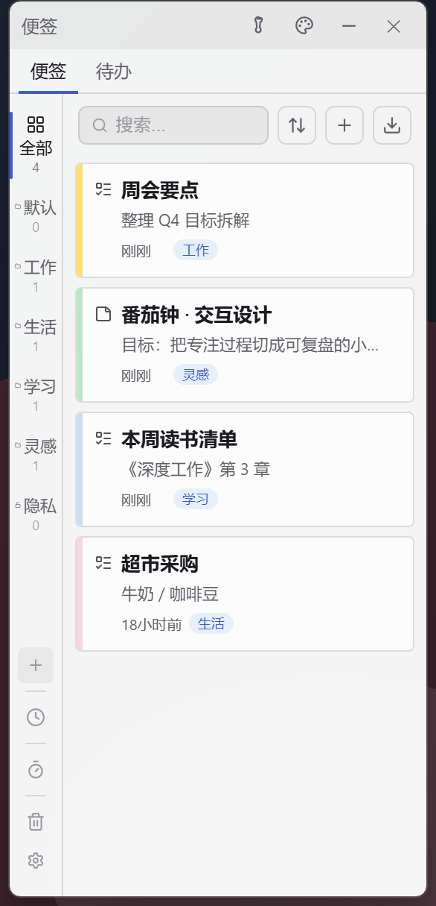
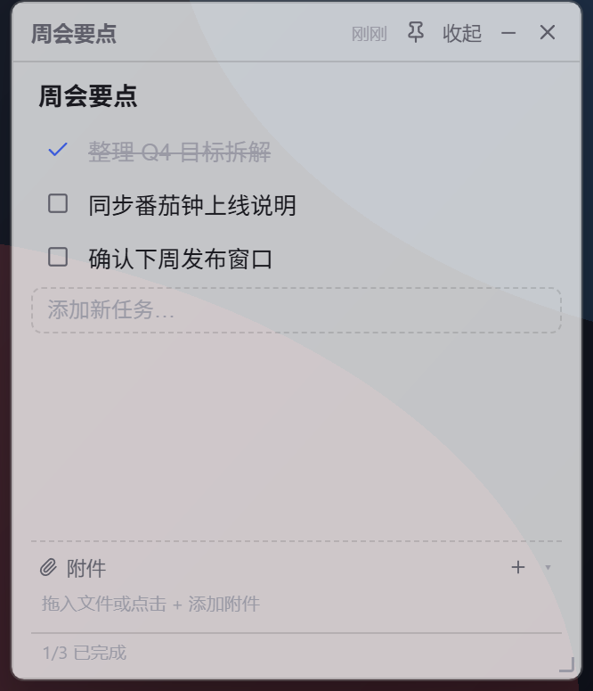
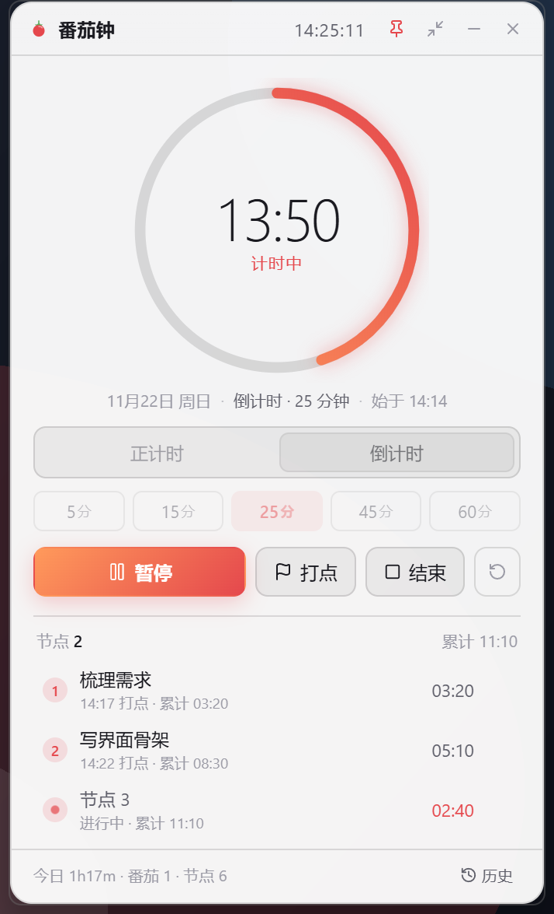
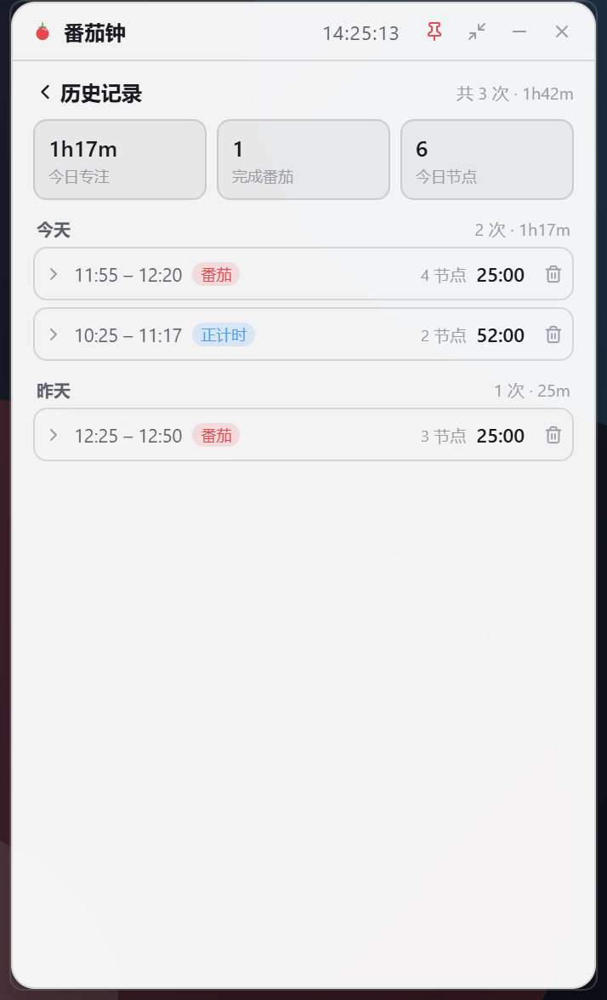

# Sticky Notes

轻量级 Windows 桌面便签 —— 每个便签都是一个独立、无边框、可透明的窗口，随手写在桌面任意角落；数据全部落在本机 SQLite，不联网也能用。

[](https://github.com/AntonStar1A1/sticky-notes/releases)
[](#安装)
[](https://v2.tauri.app/)
[](LICENSE)

<table>
  <tr>
    <td align="center"></td>
    <td align="center"></td>
    <td align="center"></td>
  </tr>
  <tr align="center">
    <td><sub>管理台 —— 分组、搜索、拖拽排序</sub></td>
    <td><sub>便签窗口 —— 待办、附件、玻璃质感</sub></td>
    <td><sub>番茄钟 —— 计时 + 打点 + 统计</sub></td>
  </tr>
</table>

## 功能

**便签**

- 多窗口便签：每条便签独立窗口，透明无边框，位置与尺寸自动记住
- 待办清单：便签内嵌待办项，勾选后置灰，底部显示「1/3 已完成」
- 附件：拖入图片或文件即可挂到便签上，点击用系统默认程序打开
- 便签样式：玻璃 / 纯色 / 渐变三种窗口样式，颜色可自定义
- 字数统计：编辑区实时显示字数（可在设置中关闭）

**组织与检索**

- 分组管理：右键把便签归入分组，分组可重命名、可拖动排序
- 拖拽排序：分组与便签都支持鼠标拖拽重排，触控长按同样可用
- 搜索：按标题与内容过滤便签
- 时间轴：记录每次修改，支持新旧内容差异对比
- 回收站：删除的便签保留 30 天可恢复，到期自动清理
- 导出：单条或全部导出为 JSON / CSV

**专注（番茄钟）**

- 独立窗口，与便签主界面互不影响
- 正计时（秒表）与倒计时（5 / 15 / 25 / 45 / 60 分钟预设）
- 打点：每个节点记录段内用时、会话累计与打点时刻，可改名、可删除
- 历史：按天归档，今日 / 本周 / 累计统计，展开可查看当次所有节点
- 迷你模式：只保留环形计时，钉在最上层
- 关闭窗口会先把进行中的计时暂停存档，重开从暂停处继续

**系统集成**

- 窗口置顶：便签与管理台都能一键 pin 在最前
- 边缘吸附：贴边自动收起，鼠标靠近再滑出
- 全局快捷键：新建便签 / 剪贴板建便签 / 快速记录 / 唤起番茄钟
- 系统托盘：关窗口只是收进托盘，可完全后台运行
- 隐私锁：给「隐私」分组设置密码，忘记密码可用两个安全问题重置
- 自动更新：应用内检查并安装新版本，安装包经 minisign 签名校验

## 番茄钟

番茄钟是一个独立窗口，可以从**管理台左侧工具栏的秒表图标**、**托盘菜单「番茄钟」**、或按 `Ctrl+Shift+P` 打开。

| 场景 | 行为 |
|------|------|
| 正计时 | 从 0 累加，环形进度按 25 分钟一圈循环，适合记录不限时的专注 |
| 倒计时 | 到点自动收尾存档，播放提示音并把窗口提到前台 + 任务栏闪烁 |
| 打点 | 记录「距上一节点用了多久 / 会话累计 / 打点时刻」，正在进行的一段实时显示 |
| 结束 | 写入历史；时长不足 30 秒且没有任何节点时自动丢弃，不污染统计 |
| 重置 | 二次确认后丢弃当前会话（节点一并删除） |
| 关闭 × | 窗口真正关闭；进行中的计时会先按墙上时钟暂停存档 |
| 最小化 | 窗口收进任务栏但计时继续，倒计时到点仍会提醒 |

窗口内快捷键：`空格` 开始 / 暂停 · `L` 打点 · `H` 历史 · `Esc` 收起迷你或返回

<p align="center">
  
  <br>
  <sub>历史按天归档，展开可看当次的每个节点</sub>
</p>

计时口径说明：会话只存「已累计毫秒」与「当前运行段起点」，实际用时 = 累计 + 当前时间 − 起点。因此隐藏窗口、系统休眠、甚至重启应用后再次打开，计时都能无缝续上，不会因为渲染节流而漂移。

## 默认快捷键

| 快捷键 | 作用 |
|--------|------|
| `Ctrl+Shift+N` | 新建文字便签 |
| `Ctrl+Shift+V` | 用剪贴板内容创建便签 |
| `Ctrl+Shift+Q` | 唤出快速记录栏（回车存为便签） |
| `Ctrl+Shift+P` | 番茄钟：前台时收起，否则唤起 / 置前 |

全部可在 **设置 → 快捷键** 中修改；注册失败时会提示冲突（例如被其它软件占用），换一组即可。

## 安装

从 [GitHub Releases](https://github.com/AntonStar1A1/sticky-notes/releases) 下载最新版本：

| 文件 | 说明 |
|------|------|
| `Sticky.Notes_<版本>_x64-setup.exe` | NSIS 安装程序，推荐；支持应用内自动更新 |
| `Sticky.Notes_<版本>_x64_en-US.msi` | MSI 安装包，适合批量部署 |
| `Sticky.Notes_<版本>_x64_portable.zip` | 便携免安装版，解压即用，数据存在 exe 旁 |

> 自动更新走 `releases/latest/download/latest.json`，只认签名安装包。手动覆盖安装同样是安全的，配置与数据不会丢。

### 数据存放位置

| 形态 | 路径 |
|------|------|
| 安装版 | `%APPDATA%\com.stickynotes.app\sticky_notes.db` |
| 便携版 | `exe 同级目录\data\sticky_notes.db`（需要同目录存在空的 `portable.txt` 标记文件） |

升级前建议先在工具栏「导出全部」做一次备份。

## 技术栈

| 层级 | 技术 |
|------|------|
| 前端 | React 19 · TypeScript · Vite · Lucide Icons |
| 后端 | Tauri 2 · Rust · SQLite（rusqlite，WAL 关闭、单连接串行） |
| 更新 | tauri-plugin-updater（minisign 签名 + `latest.json` 清单） |
| 构建 | NSIS / MSI 安装包 · 便携 zip |

## 开发

### 环境要求

- Windows 10 / 11（WebView2 运行时由系统自带或随安装包安装）
- [Node.js](https://nodejs.org/) >= 18
- [Rust](https://www.rust-lang.org/tools/install)（stable）
- [Tauri 2 前置依赖](https://v2.tauri.app/start/prerequisites/)

### 常用命令

```bash
npm install          # 安装依赖
npm run tauri dev    # 开发：前端热更新 + Tauri 窗口
npm run build        # 仅构建前端（tsc -b && vite build）
npm run tauri build  # 构建 NSIS + MSI 安装包
npm run lint         # oxlint 静态检查
```

Rust 侧单测（数据库迁移、便签生命周期、番茄钟折算等 22 项）：

```bash
cd src-tauri
cargo test --offline
```

### 发布新版本

1. **同步版本号** —— `package.json`、`src-tauri/tauri.conf.json`、`src-tauri/Cargo.toml`（自动更新按 Cargo.toml 的版本判断）
2. **构建** `npm run tauri build`，产物在 `src-tauri/target/release/bundle/`
3. **整理资产** —— 安装包改名为 `Sticky.Notes_<版本>_x64-*.exe/.msi`；便携版用 `sticky-notes.exe` + 空 `portable.txt` 打成 zip
4. **签名 NSIS 安装包**（密钥在 `~/.tauri/sticky-notes.key`）

   ```bash
   node node_modules/@tauri-apps/cli/tauri.js signer sign \
     -f ~/.tauri/sticky-notes.key \
     -p '<密钥口令>' \
     'Sticky.Notes_<版本>_x64-setup.exe'
   ```

5. **生成 `latest.json`**（`signature` 直接取 `.sig` 文件内容）

   ```json
   {
     "version": "<版本>",
     "notes": "本次更新说明",
     "pub_date": "2026-11-22T05:25:44.829Z",
     "platforms": {
       "windows-x86_64": {
         "signature": "<.sig 文件内容>",
         "url": "https://github.com/AntonStar1A1/sticky-notes/releases/download/v<版本>/<安装包文件名>"
       }
     }
   }
   ```

6. **创建 Release**（tag 用 `v<版本>`，四个资产一起上传）

   ```bash
   gh release create v<版本> --latest --title "Sticky Notes v<版本>" \
     --notes-file notes.md \
     Sticky.Notes_<版本>_x64-setup.exe \
     Sticky.Notes_<版本>_x64_en-US.msi \
     Sticky.Notes_<版本>_x64_portable.zip \
     latest.json
   ```

7. **自检** —— `releases/latest/download/latest.json` 能取到新版本；用内置公钥验证 `.sig` 通过；确认 `/releases/latest` 已指向新 tag

> [!WARNING]
> 签名密钥一旦更换，旧版本内置的公钥无法验证新签名，已安装的旧版本必须手动安装一次（v0.1.3 → v0.1.4 就是这样），之后的版本恢复正常自动更新。

## 项目结构

```
Sticky_notes/
├── index.html / note.html / capture.html / pomodoro.html   # 四个窗口入口
├── src/
│   ├── App.tsx             # 管理台（分组、搜索、时间轴、回收站、设置）
│   ├── NoteApp.tsx         # 便签窗口（文本 / 待办 / 附件）
│   ├── CaptureApp.tsx      # 快速记录栏
│   ├── PomodoroApp.tsx     # 番茄钟窗口
│   ├── components/         # UI 组件（含 pomodoro/ 子目录）
│   ├── hooks/              # usePomodoro 计时引擎、useEdgeDock 边缘吸附等
│   ├── pomodoro/           # 番茄钟数据接口、格式化、偏好、提示音
│   └── types.ts            # 前后端共享类型
├── src-tauri/
│   ├── src/main.rs         # Tauri 入口、命令注册、窗口与托盘
│   ├── src/db.rs           # SQLite 建表、迁移与所有数据操作
│   ├── capabilities/       # 窗口 ACL 权限（新增窗口记得加进来）
│   ├── tauri.conf.json     # 打包与更新配置
│   └── Cargo.toml
├── screenshots/            # README 用截图
├── design-preview/         # 静态设计预览页
└── package.json
```

## 常见问题

**检查更新失败？** 更新清单地址是 GitHub Releases，网络受限时会超时；挂代理后重试，或直接下载新版本覆盖安装。

**便携版数据在哪？** 便携版把数据放在 exe 同级的 `data\` 目录，需要同目录存在空文件 `portable.txt` 才会启用便携模式，否则仍写 `%APPDATA%`。

**忘记隐私分类密码？** 设置 → 安全 → 忘记密码，答对创建时设置的两个安全问题即可重置。

**新增窗口后按钮点不动？** 很可能是忘了在 `src-tauri/capabilities/default.json` 的 `windows` 里登记新窗口标签——窗口 API 会被权限系统拒绝（v0.1.5 的番茄钟就踩过这个坑，v0.1.6 已修复）。

## 更新日志

见 [CHANGELOG.md](CHANGELOG.md)。

## License

[MIT](LICENSE)
